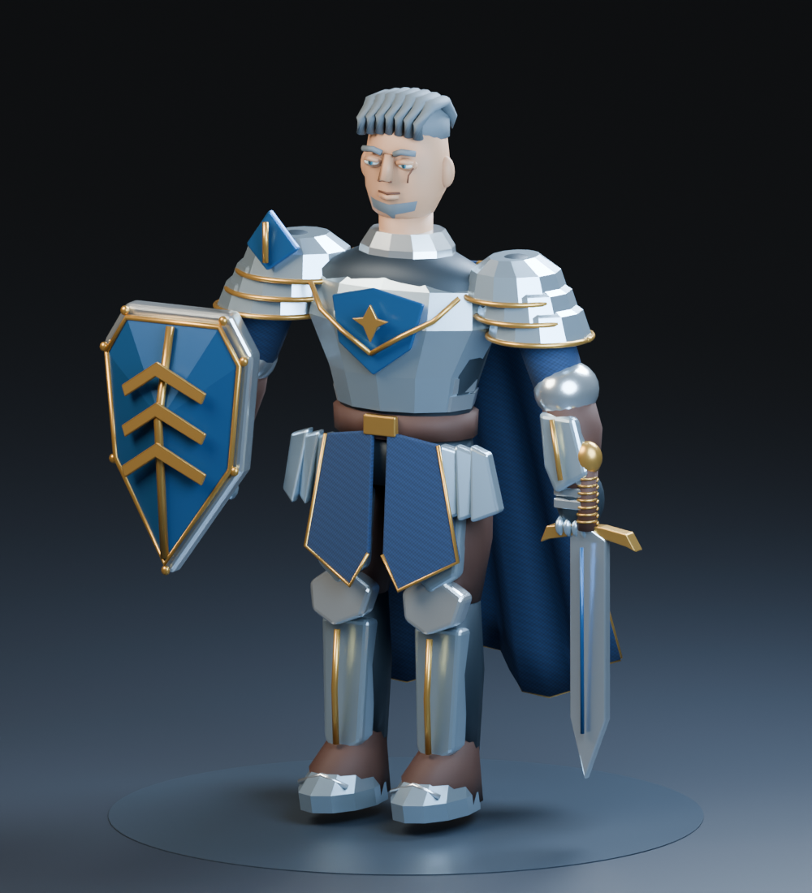
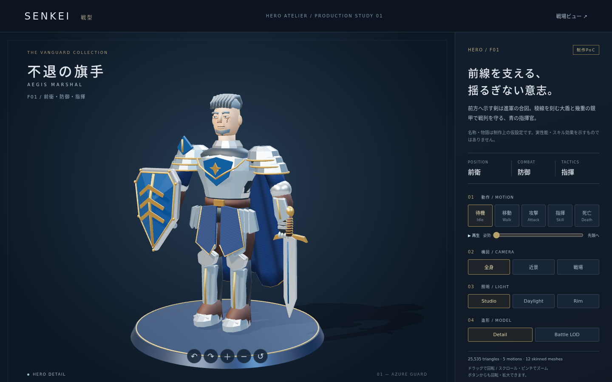

# F01 original production PoC — rejected v1

**これは旧版 `04c7a84` の記録です。造形品質はレビューで不採用となりました。現行の対応と出典・ライセンスは [F01-REVIEW.md](F01-REVIEW.md) を参照してください。以下の自作素材・材質数・ボーン数などの記述は旧版に関するものです。**

F01（前衛 × 防御 × 指揮）のモデル、共通リグの5動作、Detail/Battle GLB、独立したThree.jsプレビューを制作した。名前は **Aegis Marshal / 不退の旗手**（制作仮称）。青の外套、銀甲、金の階級章、三段シェブロンの大盾、銀髪と頬の傷を持つ。制作PoCとして鑑賞・再生成可能な成果物であり、最終AAA品質の達成判定ではない。




## Authority / isolation

ベースは取得時main `b258a47`。`HERO-ATELIER.md`、`GRAPHICS.md`、`GRAPHICS-DELIVERY.md`、`UNITS.md`、`UI-DESIGN.md` と既存Renderer／Vite構成を確認した。適用するAGENTS.md／追加のガバナンスファイルはなく、GitHub rulesetsは確認時に空だった。専用worktree `/home/sophia/src/senkei-f01`、ブランチ `feat/blender-f01-poc` を使用。進行中のSenritsuブランチ／worktreeには変更していない。

既存のThree.jsとReactを使用。`/hero/` はCatalogをimportせず、表示用manifestの `hero.f01.aegis-marshal.v1` を解決する。戦闘・Replay・Enbu・Jinrei・Senritsuのコードは変更していない。専用ページから戦場ビューへ移動可能。戦場へのモデル組込みや他Heroの制作は対象外。

## Reproduce on NixOS

既存環境は `tests/browser/run-nix.sh` の `nix shell nixpkgs#chromium` 方式。システム設定を変更せず、まず `nix shell nixpkgs#blender` でCLIとPython APIを検証した。今回は同じnixpkgs revisionを `flake.lock` に固定した開発shellを追加した。Blender 5.2.2 LTS / Node 24 / Chromiumを提供する。

```bash
nix develop
npm ci
blender --background --factory-startup \
  --python-expr "import bpy; print('Blender Python OK', bpy.app.version_string)"
npm run assets:build       # mesh, rig, clips, .blend, 2 GLBs, manifest, 11 Cycles images
npm run assets:validate    # Khronos glTF Validator + manifest/rig/texture/clip checks
npm run build
npm run test:browser -- tests/visual/hero-f01.spec.ts
npm run dev               # http://localhost:5173/hero/
```

レンダリングを省く再生成:

```bash
blender --background --factory-startup --python-exit-code 1 --threads 8 \
  --python tools/assets/build_hero.py -- --hero f01
```

`assets/generated` が配布元。`assets:stage` はmanifestに従ってGLBをViteのpublicへコピーし、`predev`／`prebuild`／`prepreview`で実行する。コピー先はGit管理しない。GLBを二重に手編集しない。

将来は `sources/heroes/f02.py` 等に `SPEC` と `build()` を定義し、同じentry pointの `--hero f02`、`npm run assets:validate -- f02`、`npm run assets:stage -- f02` を使う。共有の16ボーン、Action生成、材質・形状部品、LOD・manifest出力を再利用できる。ただし固有装備に合う動作・クリッピングの目視調整はHeroごとに必要。未制作の11体を対応済みとは扱わない。

## Modeling / delivery structure

単純なprimitiveの配置だけでなく、断面から作る胸甲・顎・脚、面取りした装甲板、稜線付きの盾、ダイヤモンド断面の剣、重なった肩甲・手甲、曲線の金属縁と髪束、プリーツ状の外套をメッシュとして作る。法線を再計算し、面のある装甲とスムーズな身体・曲線を使い分ける。肌／金属／革／布など12 PBR材質、UV、オリジナル織物画像をGLBに格納する。外部素材は不使用。出典・ライセンスは [assets/README.md](../assets/README.md)。

モデルは `assets/generated/f01/f01.blend`。台座・照明・カメラはGLBに含めず、Blenderレンダー／Three.js双方で展示ステージを別途構成する。メッシュは16ボーンの共通humanoidへ主に剛体ウェイトでbind。装甲の形を保つ方針で、顔リグ・指の関節・布シミュレーションは含まない。BattleはDetailを同じスキン／材質／動作のまま約35%へdecimateしたもの。三角形数・バイト数・SHA-256は [manifest](../assets/manifests/f01.json) を正本とする。

## Animation contract

30fps、in-place。GLBでは秒単位、Y-up／+Z正面。アクション切替時に全ボーンの状態をリセットする。各クリップは全ボーンの回転と位置をサンプリングし、前のクリップの姿勢が残らない。

| Clip | Duration | Loop | Start → end |
| --- | ---: | --- | --- |
| Idle | 2.967s | yes | guard → guard、呼吸と頭の微動 |
| Walk | 0.967s | yes | guard → guard、交互の脚・腕、骨盤補正 |
| Attack | 1.367s | no | guard → guard、振りかぶりから切り下ろし |
| Skill | 1.967s | no | guard → guard、剣を前方へ示す指揮合図 |
| Death | 2.167s | no | guard → 仰向け、終端を保持 |

共通リグの動作見本であり、当たり判定・攻撃時刻・スキル効果の実装ではない。Walkにroot motionは含めない。プレビューはIdle／Walkのみ繰返し、Attack／Skill／Deathは一度再生し終端を保持する。姿勢スライダーは停止状態で確認でき、別動作／LODのロードで位置をリセットする。reduced-motionでは初期停止。

## Evidence and verification

Khronos `gltf-validator@2.0.0-dev.3.10` で両GLBを検証。両LODともエラー0件・警告0件。完全な [検証JSON](evidence/f01/gltf-validation.json) に、エラー・警告、生成元とGLBのハッシュ、スキン、埋込テクスチャ、5クリップ、ループとguard終端の一致を記録する。quaternionのq／−qは同じ姿勢として比較する。UVのある未テクスチャ材質についての `UNUSED_OBJECT` は情報メッセージで、エラー／警告ではない。

独立した再生成も実行した。[再生成照合](evidence/f01/regeneration.json) では両LODともJSON構造、形状、法線、スキン、動作、テクスチャが一致した。UVの一部だけ最大 `1.1921e-7` のfloat差があり、GLBのバイト列／SHA-256は毎回同一とは限らない。数値許容差 `1e-6` 内で同等と判定し、manifestは納品する実ファイルのSHA-256を保持する。

実Chromium／WebGL2（SwiftShader）でGLBをHTTPロードし、描画・5動作の姿勢変化・Idleの時間進行・Death終端保持・回転・ズーム・3照明・LOD往復と全動作・ロード失敗／GPU失敗・reduced-motionを検証。1440×900、1920×1080、390×844、430×932、320px幅のスクリーンショットを取得する。F01ブラウザテスト3件、既存Replayブラウザ回帰9件、既存単体テスト25件、TypeScript／production buildが成功した。証拠は [browser-validation.json](evidence/f01/browser-validation.json) と [操作動画](evidence/f01/browser-interaction.webm)。ソフトウェア描画であり、実機GPUでのFPS・多数体性能は今回の測定対象外。

| 観点 | Blender image | Browser image |
| --- | --- | --- |
| 正面 | [front](evidence/f01/blender-front.png) | [全身](evidence/f01/browser-desktop-detail.png) |
| 側面 | [side](evidence/f01/blender-side.png) | 回転操作を動画で確認 |
| 背面 | [back](evidence/f01/blender-back.png) | 同上 |
| 斜め | [three-quarter](evidence/f01/blender-three-quarter.png) | [全身](evidence/f01/browser-desktop-detail.png) |
| 顔・上半身 | [close-up](evidence/f01/blender-close-up.png) | [portrait](evidence/f01/browser-portrait.png) |
| Hero Detail | [hero-detail](evidence/f01/blender-hero-detail.png) | [1920×1080](evidence/f01/browser-1920x1080.png) |
| 戦場縮小 | [battlefield](evidence/f01/blender-battlefield.png) | [Detail](evidence/f01/browser-battle-detail.png) / [LOD](evidence/f01/browser-battle-lod.png) |
| 動作 | [Walk](evidence/f01/blender-pose-walk.png) / [Attack](evidence/f01/blender-pose-attack.png) / [Skill](evidence/f01/blender-pose-skill.png) / [Death](evidence/f01/blender-pose-death.png) | [Idle](evidence/f01/browser-motion-idle.png) / [Walk](evidence/f01/browser-motion-walk.png) / [Attack](evidence/f01/browser-motion-attack.png) / [Skill](evidence/f01/browser-motion-skill.png) / [Death](evidence/f01/browser-motion-death.png) |
| 小画面 | — | [390px](evidence/f01/browser-390x844.png) / [430px](evidence/f01/browser-430x932.png) / [320px](evidence/f01/browser-320x844.png) |
| 照明 | key/fill/rim | [Daylight](evidence/f01/browser-daylight.png) / [Rim](evidence/f01/browser-rim.png) |

## Visual assessment / limitations

実レンダリングを目視し、目の突出、髪の反復形状、背面の胸甲と外套の干渉、歩行の足の浮き、タバードへの脚甲の突抜けを発見して修正した。ビルド成功や画像ファイルの存在を美観のPASSとしていない。

| 受入視点 | 評価 |
| --- | --- |
| 1. Hero identity | 大盾・三段階級章・片側の指揮官crest・銀髪・青外套でF01の個性を持たせた。12体間の識別比較は未実施 |
| 2. 装備と身体 | 正面・側面・背面・斜めで装甲／武器を確認。板金の平面を強調した様式。背面干渉を修正 |
| 3. 近景鑑賞 | 顔・目蓋・眉・傷・髪束・装甲の縁が見える。顔・髪の彫刻の自然さ、表情、皮膚の精細感はAAA最終品質に未達 |
| 4. 遠景 | 同じidentityの盾・幅広い肩・青外套が残る。細い金縁と顔の情報は縮小で失われる。多人数の実戦読みやすさは未測定 |
| 5. 動作 | 5動作のBlender画像とGLB実再生を確認。Walkの接地を補正。鎧は剛体追従、外套はspine追従で、布の慣性・接触解決・IKは未実装。装備の全フレーム接触を保証するものではない |
| 6. 再生成 | 固定Nix環境、生成スクリプト、.blend、ハッシュ付きmanifest、検証コマンドを提供。再生成の構造一致と数値許容差を確認 |
| 7. Browser | 実HTTPロード、WebGL2描画、操作、両LODと全5動作を確認。GPU性能の保証とは分ける |
| 8. 独立性 | 表示用manifestとRendererだけに依存し、ゲームルール・Hero Catalogに依存しない |

LODは単純decimation由来で、専用の手作業retopologyや複数体向けmaterial atlas／draw call統合は未実施。12材質のためブラウザは12 skinned primitivesを描く。法線マップや高低polyベイクはなく、ディテールの多くを実ジオメトリで表現した。今回の成果は制作可能性と鑑賞用F01を納品するPoCであり、量産やAAA受入の最終承認を代替しない。

## Blender MCP decision

[公式リポジトリ](https://github.com/ahujasid/mcp-for-blender) と [server.py](https://github.com/ahujasid/mcp-for-blender/blob/febcd90ece59c3416d7c55fd3723cea46bcaa59d/src/blender_mcp/server.py)、[addon.py](https://github.com/ahujasid/mcp-for-blender/blob/febcd90ece59c3416d7c55fd3723cea46bcaa59d/addon.py) を確認した。コミュニティ製でBlender Foundation公式ではない。Codexは `codex mcp add blender -- uvx mcp-for-blender` でstdio MCPサーバーを登録し、サーバーからBlenderアドオンのローカルsocket（既定localhost:9876）に接続する構成。scene／object照会、Python実行、viewport画像取得、外部素材サービス連携等を提供する。

任意Python実行能力があり、ローカルコード実行と同じ信頼境界で扱う必要がある。今回は接続方式・主要実装の確認であり、プロジェクト全体のセキュリティ監査は行っていない。CLIで生成・画像取得・GLB検証まで実行できるため、MCP／アドオンの導入・Codex設定変更・ポート公開は行わなかった。将来導入する場合もバージョンを固定し、ローカル接続に限定する。
