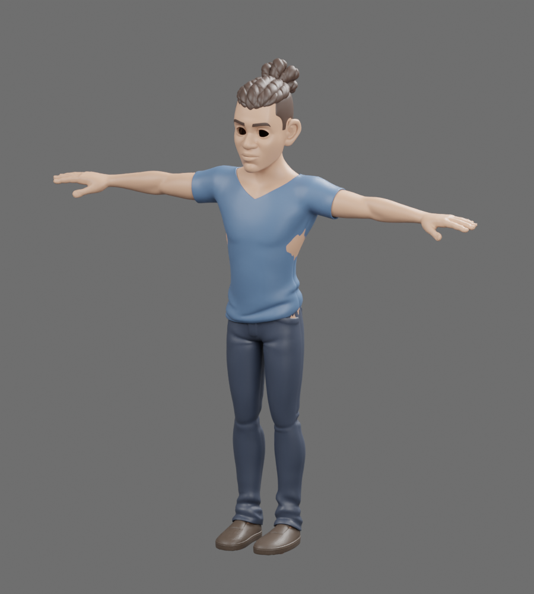
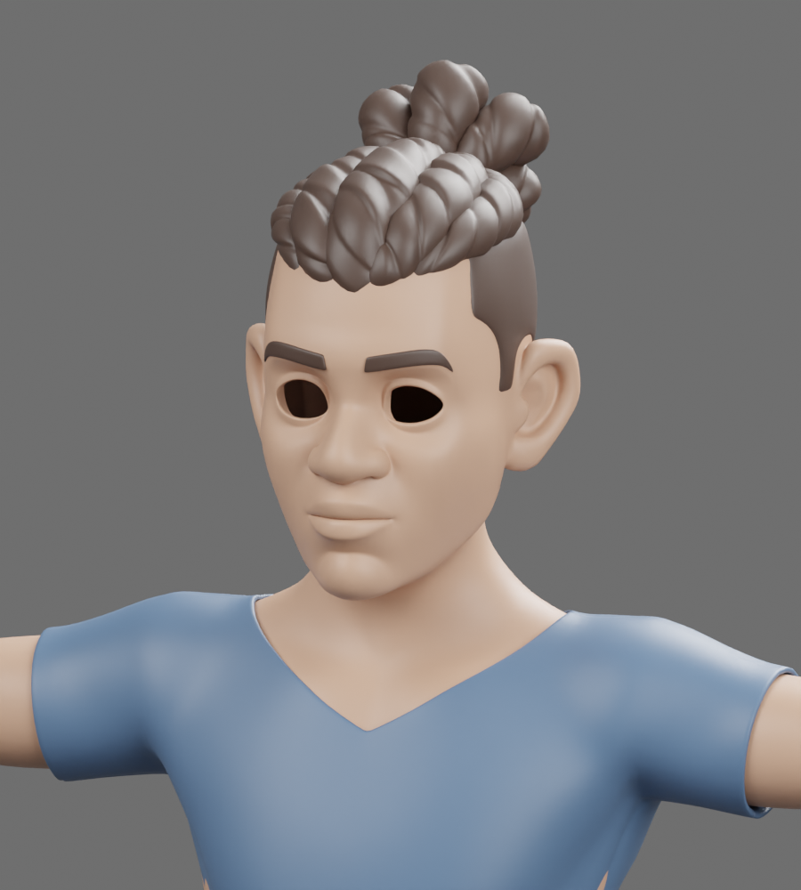

# F01 review response — in progress

対象: [PR #4 の造形品質却下レビュー](https://github.com/yohn-jp/senkei/pull/4#issuecomment-6384389720)。旧F01は不採用のart-direction prototype。既存画像・テスト成功は造形の受入を意味しない。旧モデルを12体制作のテンプレートにはしない。

## Checkpoint 1 — modeling input / provenance

旧primitive人体を磨くだけの方針を取りやめ、Blender Studioの実メッシュを評価した。

| 候補 | 調査結果 | 判断 |
| --- | --- | --- |
| [Human Base Meshes v1.4.1](https://www.blender.org/download/demo-files/#asset-bundles) | 公式配布ページのCC0表示、ZIPを取得し、stylized / realistic人体・顔・手・目などの収録メッシュを確認 | 人体トポロジーの素材。今回は髪を含む一貫した人体があるSnowを優先 |
| [Snow v4.2](https://studio.blender.org/characters/snow/v4/) | 公式配布ZIPと.blendを取得。顔・髪・胴体・手足・衣服・目のメッシュ、元の変形ボーン／ウェイトを確認。Blenderで形状を実レンダリング | 改訂F01の人体入力として採用し、F01装備とSenkeiリグへ適合中 |

SnowはCC-BY 4.0。[原配布.blendとライセンス証拠](../assets/sources/vendor/snow-v4.2/provenance.json)、[配布元の許諾記載](../assets/sources/vendor/snow-v4.2/license-evidence.json)、[ライセンス全文](../assets/sources/vendor/snow-v4.2/LICENSE-CC-BY-4.0.txt)を管理する。クレジット: **Snow Rig (CC) Blender Foundation | studio.blender.org**。原素材の外部テクスチャは取り込まず、Senkeiの材質へ置換する。CC-BY由来形状をApache-2.0だけの自作形状として扱わない。

原.blendの埋込Pythonは実行していない（`--disable-autoexec` / `use_scripts=False`）。配布元の制御リグ・drivers・shader・外部画像への依存をそのままゲームへ持ち込む方式ではなく、人体メッシュとウェイトを抽出して共通リグへ適合する。

### Source inspection renders

これは採用前の形状確認用の簡易材質レンダーであり、F01完成画像ではない。目のviewport用コレクションが原ファイルでrender非表示のため、この画像では眼球が出ていない。抽出工程で表示・材質を修復してから顔の最終評価を行う。

## Remaining checkpoints

- 改訂人体の顔・目・髪、身体比率を装備に合わせ、肩の積層形状と接続、外套の立体的なドレープを修正する。
- 共通リグへ再bindし、五動作の接地・重心・武器保持・装備／外套の干渉を実画像で調整する。
- Detail / Battle LOD、GLB容量、材質／draw callを再評価する。
- 旧版との比較、各方向・顔・五動作・実ChromiumのDetail / Battle画像を提出する。
- GLB検証、再生成照合、TypeScript/build、ブラウザ動作テストを再実行し、残る欠点を報告する。

このcheckpointでは、改訂モデル・動作の完成や造形品質の受入は宣言しない。既存パイプライン・プレビューは維持する。PR #3との統合やmainへのmergeはしない。
