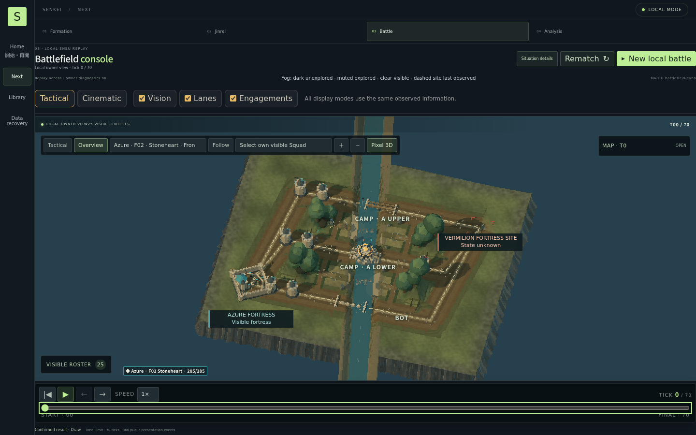
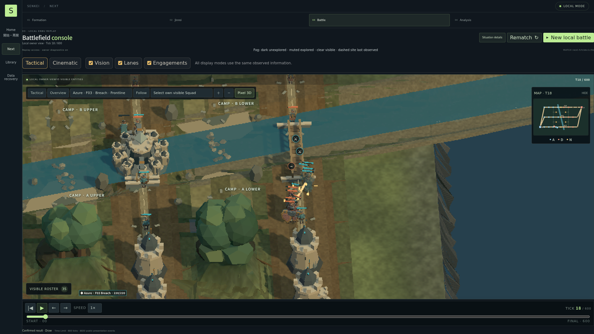
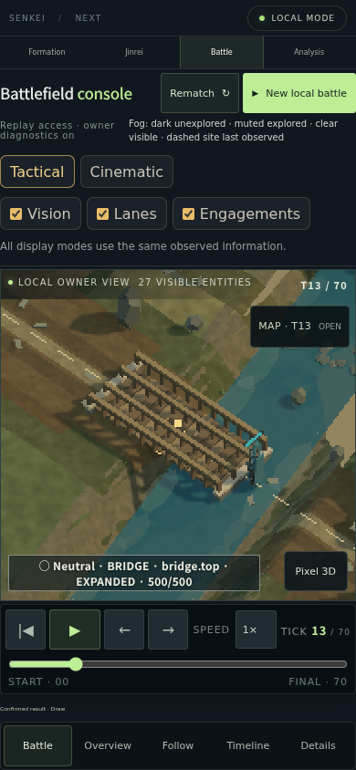
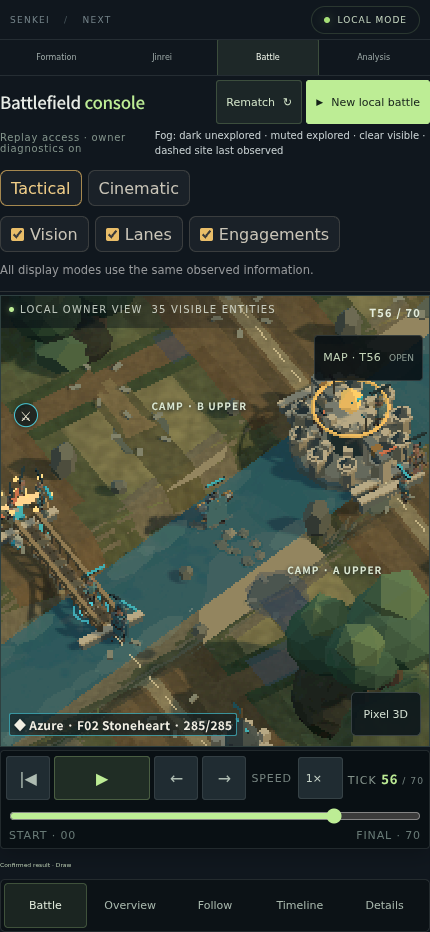
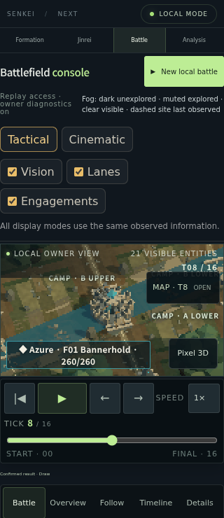
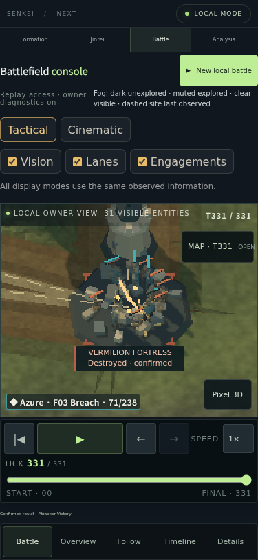

# Current World — verified Tactical capture selection

Source/build: `9b00d11a21b8f3996b42f84a8f0c18b8bca9369e`. The full six-viewport production run passed with 204 captures. These six images retain their original image hashes, Tick, camera and authorized replay facts in [metadata.json](metadata.json). They are a pinned Tactical implementation baseline, not final user art or hardware acceptance. Cinematic mode has a later camera implementation; its desktop/mobile evidence is recorded in [canonical-browser](../../battlefield/canonical-browser/metadata.json).

